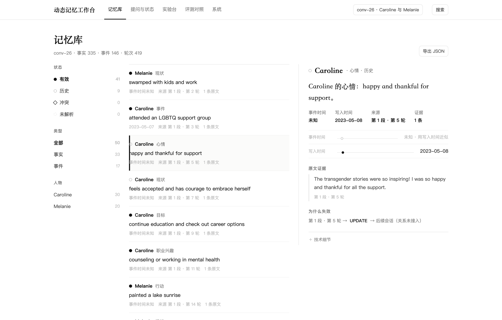

# 第 2 章 数据与结构化 Memory

## 本章结论

- 项目按课程要求固定 6 段、4+2 划分：development 四段用于选型，test 两段只读；后文所有 test 数字都来自 conv-41/42，不用开发段冒充最终结果。（来源：`docs/optimization/COURSE-REQUIREMENTS.md`）
- MemoryUnit v2 把 content、t_event、t_ingest、valid_interval、source turn、state、evidence 放在同一条记录里；conv-26 可导出 754 个 unit（419 turn + 335 fact）与 228 条去重关系。（来源：`exports/conv-26.json`）
- 结构化并不等于时间可解析：六段导出中只有 93/2602 条记录有可解析的 t_event（3.6%），多数记录只能用写入时间近似；这直接限制了第 4 章的 as-of 能力。（来源：`exports/conv-26/30/41/42/43/44.json`）

## 2.1 数据划分与使用纪律

课程指定 6 段 LoCoMo 对话：development 为 conv-26、conv-30、conv-43、conv-44；test 为 conv-41、conv-42；其余四段可作扩展（来源：`docs/optimization/COURSE-REQUIREMENTS.md`）。LoCoMo 十段平均 588.2 轮、27.2 个会话、约 1.66 万 token（来源：同上），本报告只用前六段。

| 划分 | 对话 | 用途 | 本报告中的数字 |
|---|---|---|---|
| development | conv-26 / 30 / 43 / 44 | 选型、调参、单因素、R3、参数层 | S6、adoption、E3、R3、params、K3 |
| test | conv-41 / 42 | 冻结配置后只读评测 | W3 offline/online、归档 27B |

数据纪律只有一条：**test 不参与任何配置选择**。W3 在跑 test 前冻结 B0/R0，两个 seed 只换题目子集，不换配置（来源：`docs/optimization/W3-REPORT.md`）。因此第 7 章可以把 test 结果写成“冻结配置的留出评测”，但不能写成“调参后的最好结果”。

## 2.2 MemoryUnit v2：一条记录要能回答什么

v2 的字段不是“越多越好”，而是每条都要能支撑一个下游动作：

**表 2-1 MemoryUnit v2 的字段职责**

| 字段 | 作用 | 下游 |
|---|---|---|
| `content` / `structured` | 这条记忆说了什么 | 检索、回答、Web 展示 |
| `t_event` | 事实在世界中何时为真 | as-of、历史轨迹 |
| `t_ingest` | 系统何时观察到 | 回溯更正、数据过期 |
| `valid_interval` | 从何时到何时有效 | 状态过滤、冲突判断 |
| `source.turn` / `evidence` | 指回原始轮次与引文 | 证据召回、人工核查、引用 |
| `state` | ACTIVE / HISTORICAL / CONFLICT | 有效集、拒答、冲突披露 |
| `relations` | RETAIN / UPDATE / SUPERSEDE / CONFLICT | 版本链、失效链 |

表 2-1 是字段职责，不是实现细节。关键点是**每个字段都能指回原始 turn**：没有 `source.turn` 的字段无法进入证据召回，也无法在 Web 端展示原文。统一导出契约见 `memlab/export.py` 的 `memory-export@2` 校验器（来源：`memlab/export.py`）；仓库中的 `exports/conv-26.json` 仍是 v1 结构，v2 由 `/api/v2/export?schema=2`（单段）与 `/api/v2/export/all?schema=2`（6 段 bundle）生成（来源：`memlab/webapp/__init__.py`、`web/v2.js`）。

## 2.3 一条真实记录

deck 第 4 页用 `Caroline · job = teacher` 做版式示意，但 `exports/conv-26.json` 中并没有 teacher 这条记录；为了避免编造，本节改用同一对话里的真实记录 `conv26_D19_1_f0`。它是一条 adoption event：Caroline 在 D19:1 说“I passed the adoption agency interviews last Friday”，抽取结果为 event，原文时间为 2023-10-22 09:55，`time_expression` 为“last Friday”，`resolved_date` 为 2023-10-20（来源：`exports/conv-26.json`）。

按 `memory-export@2` 的字段组织，它等价于：

```json
{
  "memory_id": "conv26_D19_1_f0",
  "kind": "event",
  "text": "Caroline · event: passed adoption agency interviews",
  "structured": {"entity": "Caroline", "attribute": "event",
                 "value": "passed adoption agency interviews"},
  "t_event": {"start": "2023-10-20T00:00:00", "precision": "day"},
  "t_ingest": {"start": "2023-10-22T09:55:00", "precision": "session"},
  "valid_interval": {"start": "2023-10-20T00:00:00", "end": null},
  "evidence": [{"turn_id": "D19:1",
                "quote": "I passed the adoption agency interviews last Friday"}],
  "state": "ACTIVE",
  "relations": [{"type": "UPDATE", "from": "conv26_D17_1_f0"}]
}
```

这段 JSON 是按真实字段重排的等价格式，不是仓库里已落盘的 v2 文件；它的用途是说明契约，而不是冒充导出产物。记录里有三件事值得注意：第一，`t_event` 与 `t_ingest` 相差两天，说明“事件发生”和“系统看到”必须分开；第二，`evidence.quote` 能回到原文，Web 才能做证据核查；第三，`relations` 里有一条 UPDATE，指向 D17:1 的上一阶段记录，说明状态不是单条记录的属性，而是记录之间的关系。

## 2.4 conv-26 的规模

**表 2-2 conv-26 的规模统计**

| 统计项 | 数量 | 来源 |
|---|---:|---|
| turn | 419 | `exports/conv-26.json` |
| fact | 335 | 同上 |
| event | 146 | `data/facts/conv-26--qwen3.8_27b-q4_K_M.json` |
| 去重 relation | 228 | `exports/conv-26.json`（456 条有向关系去重） |
| slot | 88 | 同上 |
| ACTIVE / HISTORICAL / CONFLICT | 287 / 48 / 0 | 同上 |

表 2-2 的口径是“conv-26 单段导出”，不是六段总和；六段合计的 t_event 与 CONFLICT 见第 4 章。fact 与 event 的计数来自抽取缓存：335 条 fact 中有 146 条带 event 字段（来源：`data/facts/conv-26--qwen3.8_27b-q4_K_M.json`）；关系计数按无向 pair 去重后为 228，原始有向关系为 456（来源：`exports/conv-26.json`）。



*图 2 记忆记录视图：结构化字段、双时间、原文证据与失效链（来源：`web-preview/records.png`）。*

图 2 支撑本章的核心结论：结构化 Memory 不是一张宽表，而是“列表 + 详情 + 证据 + 时间轴”的组合。右侧详情同时展示 `t_event`（未知）、`t_ingest`（2023-05-08）、`valid_interval`、原文引文和“被 D4:15 更新”的失效链（来源：`web-preview/records.png`）。这也是 Web 端能解释“为什么这条记忆现在有效/已过时”的原因。

## 2.5 统一导出与校验

`memory-export@2` 的校验分三层：对象必须是 JSON object；`memory` 必填字段齐全；`evidence` 的 `turn_id` 必须能在原始对话中找到（来源：`memlab/export.py`）。仓库现有的 `exports/conv-26.json` 是 v1（`dynamic-memory-workbench/memory-export@1`），字段为 `memories/turns/slots/counts`，没有 v2 的 `t_event/valid_interval`（来源：`exports/conv-26.json`）。因此本报告在描述 v2 时，引用的是契约与 API，不把 v1 文件冒充 v2。

这个差异本身是一个交付边界：**结构化模型已经统一，但静态导出文件还没有全部迁到 v2**。课程要求的“统一 JSON 导出”在 API 层成立，在仓库快照层只部分成立；第 8 章把它列为复现限制。

## 2.6 本章边界

本章的数字只说明“数据长什么样”，不说明“系统做得好不好”。conv-26 的 754 个 unit、228 条关系是迁移规模，不是效果；t_event 3.6% 是可解析率，不是状态准确率；CONFLICT=0 是 conv-26 的导出结果，不是六段全量。下一章把这些记录放进六模块流水线，说明它们如何被写入、索引、检索、合并、使用与维护。
