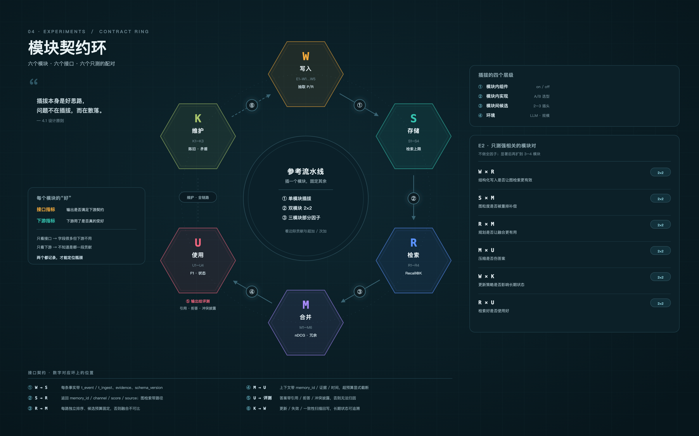

# 第 3 章 系统架构：六个可替换模块

## 本章结论

- 六模块（W→S→R→M→U→K）用接口契约固定输入输出，同一套代码、同一份数据只通过配置切换；B0 与 R0 是这条流水线上的两个冻结参考点。（来源：`docs/optimization/02-architecture.md` §2.2–2.7；`configs/reference-b0.json`、`configs/reference-r0.json`）
- 配置不是“写死在代码里的开关”，而是 registry 中的 axis/name、`config_hash` 与 runnable gate 三件事共同约束；缺实现必须 fail-closed，不能静默回退。（来源：`docs/optimization/02-architecture.md` §2.7；`docs/optimization/S6-REPORT.md` §2）
- 本项目的“图”是每次 run 从 MemoryUnit + Relation 重建的**内存图索引**，不是图数据库；这决定了图实验的规模、延迟与可复现边界。（来源：`docs/optimization/02-architecture.md` §2.14；`web-preview/new-graph.png`）

## 3.1 六个模块各回答一个问题

**表 3-1 六模块职责与失败模式**

| 模块 | 职责 | 主要接口 | 典型实现 | 失败模式 |
|---|---|---|---|---|
| W 写入 | 抽什么、怎么记 | `Extractor.extract()` → `MemoryUnit[]`；`Resolver.resolve()` → `WriteDecision` | legacy_flat / meta_schema / mem0_4action | 字段缺失、证据对不上原文 |
| S 存储 | 图、索引、时序 | `GraphBuilder.build()` → `GraphIndex`；store 的 dense/BM25/graph/temporal 索引 | state_slot / entity_triple / three_layer | 表示太细或太粗，gold 进不了索引 |
| R 检索 | 查什么、走哪路 | `QueryAnalyzer.analyze()` → `QueryFrame`；`Planner.plan()` → `Plan`；`Retriever.retrieve()` → `Candidate[]` | none / rule_router / DAG；dense/bm25/graph/temporal | 路由错、候选预算被单通道吃满 |
| M 合并 | 融合、重排、压缩 | `Fusion.fuse()`；`Reranker.rerank()`；post 的 filter/MMR/decay/compress | rrf / weighted_rrf / query_adaptive；cross_encoder | 融合权重与过滤阈值把新证据截掉 |
| U 使用 | 状态与回答 | `StateResolver.resolve()` → `StateView`；`Answerer.answer()` → `Answer` | none / offline_slot / query_llm；direct / valid_history / evidence_chain | 状态判错、上下文格式丢证据 |
| K 维护 | 更新、去重、归档 | 更新/遗忘/合并/一致性扫描；`MaintenanceResult` | none / dedupe / archive | 归档过度、旧值未失效 |

表 3-1 的“失败模式”列比“典型实现”更重要：模块不是功能清单，而是失败模式的归属。取不对先看 S/R，状态过期先看 U/K，上下文太挤先看 M；这样第 7 章的结果才能被解释成“哪一段链路坏了”，而不是“系统好/不好”。

## 3.2 接口契约：W→S→R→M→U→K

*图 1 六模块契约环：W→S→R→M→U→K 与六个接口契约（来源：`docs/optimization/figures/04-hex-contract-ring.png`）。*

图 1 把契约写成六条可检查的句子（来源：`docs/optimization/figures/04-hex-contract-ring.png`）：

1. **W→S**：每条记录必须带 `t_event` / `t_ingest` / `evidence` / `schema_version`；缺证据的记录不能进入证据召回。
2. **S→R**：检索返回 `memory_id` / `channel` / `score` / `source`；图检索还要返回 representation 与 seeds。
3. **R→M**：每路独立排序，候选预算固定；否则融合后的 Recall 不可比。
4. **M→U**：上下文带 `memory_id`、证据、时间；超预算时显式截断，不静默丢证据。
5. **U→K**：答案带引用/拒答/冲突披露；无法归因的答案不能算“完成”。
6. **K→W**：更新、失效、一致性扫描写回；长期状态可追溯。

这六条不是装饰。第 5 章的 R3 之所以能把“图实现无差异”解释成“fusion 把图候选截掉”，就是因为 R→M 的候选预算与 M→U 的上下文预算被显式记录；第 7 章的 adoption 之所以能做 strict remove，也是因为每个组件都能在配置里单独关掉。

## 3.3 同一套代码，配置切换

系统有三个约束层：

**registry。** 每个实现用 `@register(axis, name)` 注册；`build(axis, name, params)` 在找不到实现时抛 `KeyError`，并列出可用实现（来源：`docs/optimization/02-architecture.md` §2.7.1）。这保证“配置里写了一个不存在的实现”在加载时就失败，而不是跑到一半才回退。

**config_hash。** 配置加载时做 schema 校验、能力协商、`sha256(canonical_json(config))` 三件事；`config_hash` 写入 manifest 和所有缓存键（来源：`docs/optimization/02-architecture.md` §2.7.3）。同一个 `config_hash` 必须对应同一份有效配置；换了 prompt 或参数，缓存必须失效。

**runnable gate。** `guards.require_runnable` 检查实现是否真的被 executor 消费；未接线的实现不能被当成“已运行”。S6 的 R0 一度被 gate 拒绝，最后通过显式 `e2e_executor` 解决，而不是绕过 gate（来源：`docs/optimization/S6-REPORT.md` §2）。这条规则直接对应第 7 章的几个零效应：graph、rerank、evidence 在某个 harness 下没有真正生效，报告就写 `no_op` / `not_wired`，不写“无效”。

## 3.4 B0 与 R0：两个冻结参考点

B0 是 legacy 基线，R0 是“所有模块都接上”的参考架构。两者不是两个代码分支，而是两份配置：

**表 3-2 B0 与 R0 的关键差异**

| 模块 | B0（legacy） | R0（reference） |
|---|---|---|
| W 写入 | `legacy_flat` + `append`，无 auditor | `meta_schema`（8 字段、evidence、bitemporal）+ `mem0_4action` + `dedupe` + `llm_audit` |
| S 存储 | `state_slot`，图检索 `slot_expand` | `three_layer`（entity/event/topic），`dual_channel`，k_hop=2，max_neighbors=40 |
| R 检索 | planner `none`，dense + bm25 | `rule_router`，dense + bm25 + graph + temporal |
| M 合并 | `rrf`（rrf_k=60），无 rerank/filter/MMR/decay/compress | `query_adaptive_weights`，cross_encoder，threshold filter，MMR，time_decay，extractive compress |
| U 使用 | `valid_history`，无 citation | `query_llm` 状态解析 + `valid_history` + citation + abstain |
| K 维护 | 无 forgetting | `time_decay`，archive_after_days=180 |

表 3-2 只列关键差异，完整配置见 `configs/reference-b0.json` 与 `configs/reference-r0.json`。两个配置的 `preset` 分别是 B0/R0，`dataset` 都是 LoCoMo development、`question_limit=120`、按 category 分层；W3 在 test 上冻结它们时，只改 `split=test` 和题量，不改模块（来源：`docs/optimization/W3-REPORT.md`）。

## 3.5 图是内存索引，不是图数据库

本项目的 `GraphIndex` 是无向、无类型的邻接表；每次 run 从 MemoryUnit 与 Relation 重建，不引入 Neo4j 之类的图数据库（来源：`docs/optimization/02-architecture.md` §2.14；`docs/optimization/R3-REPORT.md` §5）。Web 端的关系图是同一个索引的可视化：conv-26 预览显示 164 个节点，节点填充表示当前有效、空心表示已过时，粗线表示推进/替换、虚线表示矛盾（来源：`web-preview/old-graph.png`）。

这个选择有三个直接后果。第一，图规模受单次 run 的内存与建图时间限制，R3 的三种表示只有 785/373、800/1016、974/1347 个节点/边（来源：`eval/archive/e1-r3-graph.json`），不是大规模图数据库。第二，图边没有类型，`dual_channel` 只能用 k-hop 近似实体通道、用归一化 BM25 近似语义通道，不能宣称实现了 typed dual-channel（来源：`docs/optimization/R3-REPORT.md` §5）。第三，图可以在每次 run 重建，所以缓存键必须包含 `graph_impl` 与 `graph_params`，否则换实现会复用上一份候选（来源：`docs/optimization/R3-REPORT.md` §2）。

## 3.6 本章边界

本章说明“系统怎么搭”，不说明“系统多好”。可插拔成立，不等于每个插头都有增益：第 7 章会看到 graph/rerank 在某个 harness 下是 no-op，planner/fusion 的零效应先要怀疑接线。把架构与效果分开写，是后面所有负结果能够被正确解释的前提。
