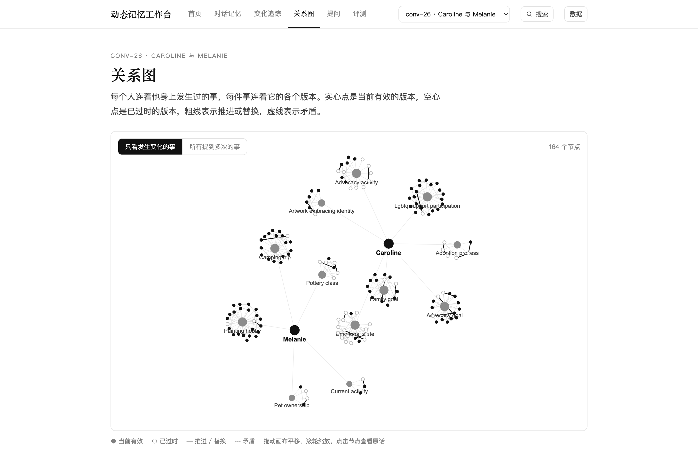

# 第 5 章 检索、合并与后处理

## 本章结论

- 四通道（BM25 / dense / graph / temporal）与三种规划器（none / rule_router / DAG）的组合空间很大，但真正改变最终证据集合的往往是融合权重、过滤阈值与候选预算，而不是再换一个图实现。（来源：`eval/archive/e1-r3-graph.json`；`docs/optimization/R3-REPORT.md`）
- R3 中所有图实现的最终 Recall 都是 0.2372，vector_only 为 0.2257；图通道新增候选进入最终上下文 0 条，瓶颈在路由（8/61）与 fusion/filter，不在图 impl 本身。（来源：`eval/archive/e1-r3-graph.json`）
- 参数层只有 `retrieval.k`、`fusion.rrf_k`、`post.filter` 呈现可复现的权衡；`max_neighbors` 已接线但不 binding，`schema.evidence` 是 no_op，MMR×decay 的顺序交互未测。（来源：`eval/archive/params-planner-k-corrected.json`、`params-graph-max-neighbors-corrected.json`、`e1-params-ext.json`、`docs/optimization/params-corrections.md`）

## 5.1 四通道与规划器

| 通道 | 召回什么 | 主要参数 | 典型失败 |
|---|---|---|---|
| BM25 | 词面匹配、实体名、罕见词 | k、tokenizer | 同义改写、跨语言 |
| dense | 语义相似 | embedding、k、distance | 弱 embedding 下退化为噪声 |
| graph | 同实体/同槽位/多跳关系 | repr、impl、k_hop、max_neighbors、PPR α | 路由不到、边无类型、候选被截 |
| temporal | 时间邻近/有效区间 | as_of、decay λ、窗口 | t_event 缺失、旧值混入 |

规划器有三档：`none` 只用单节点；`rule_router` 按 query 意图走快路径；`dag` 把多跳/时序问题拆成有依赖的子问题，再拓扑执行（来源：`docs/optimization/02-architecture.md` §2.6.3；`configs/reference-r0.json`）。R0 默认 `rule_router`，不是 DAG；DAG 只在需要多子问题时生成。这个区别很重要：第 7 章 R1 的 online 结果里，rule_router 的 F1 为 0.1540，而 none/DAG 都是 0.1243（来源：`eval/archive/s6-e1-online-40.json`）；DAG 没有赢，不等于“规划无用”，而是“在这 40 题上，DAG 的额外节点没有转化为答案”。

## 5.2 融合、重排与后处理

R0 的合并顺序是：**RRF/加权融合 → cross-encoder 重排 → MMR → time decay → extractive compress**（来源：`configs/reference-r0.json`）。每一步解决一个不同问题：

- 融合解决多路分数量纲不一致；R0 用 `query_adaptive_weights`，基础权重 dense 0.45 / bm25 0.35 / graph 0.20，再按 query 类型调整（来源：`configs/reference-r0.json`）。
- 重排解决“候选相关但排序不对”；R0 配 `BAAI/bge-reranker-v2-m3`，top_n=50。但当前机器没有 GPU，cross-encoder 回退，重排增益不可测（来源：`docs/optimization/S6-REPORT.md` §6）。
- MMR 解决冗余；decay 解决陈旧；compress 解决 token 预算。三者都会改变最终上下文，因此 adoption 不能只看 Recall。

这里有一个容易误读的点：融合后的 Recall 可能高于单通道，但最终答案不一定更好，因为 filter/MMR/compress 会继续裁剪。第 7 章的 adoption 中，remove filter 让 Recall 上升 +0.0889、nDCG 上升 +0.0564，但 token 增加 +53.31（来源：`eval/archive/e1-adoption-offline.json`）。这不是“filter 有害”，而是“在当前预算下，threshold 过滤把一些有用证据也删了”；报告只写条件，不写道德判断。

## 5.3 图检索：四种表示、五种实现

**四种表示**：`state_slot`（按实体+槽位的版本链）、`entity_triple`（实体三元组）、`three_layer`（entity/event/topic 三层）、`event_sparse`（事件节点，离线确定性版）。R3 主矩阵使用前三种；`event_sparse` 是后续补的离线实现，没有进入 13 格（来源：`docs/optimization/S6-REPORT.md` §10.1；`configs/experiment-catalog.json`）。

**五种实现**：`vector_only`（关闭图通道的弱基线）、`slot_expand`（同槽位版本链扩展）、`entity_subgraph`（原 k-hop 语义）、`dual_channel`（实体通道 + 归一化 BM25 语义通道）、`ppr`（纯 Python 幂迭代 personalized PageRank，α=0.15、top_k=30、固定 50 次迭代）。`community_summary` 与 `hybrid_graph` 注册为显式 `NotImplementedError`，不静默退化（来源：`docs/optimization/R3-REPORT.md` §2）。

R3 接线前，`graph.retrieval.impl` 只用于校验和取参数，`_channels_for()` 对 multi-hop 硬编码 `graph_khop`，`vector_only` 关不掉图通道；接线后，新增 `graph.retrieval` 注册轴与 dispatch，`vector_only` 返回空候选，DAG/RuleRouter 不再加图节点，缓存键加入 `graph_impl` 与 `graph_params`（来源：`docs/optimization/R3-REPORT.md` §2）。这一步是“可插拔”从口号变成实验条件的关键：没有 dispatch，S1/S2/S3 三种表示其实跑的是同一段 k-hop，差异不能归因于表示。

## 5.4 关系图为什么用旧版布局

*图 3 关系图：力导向布局 + 语义边，实心当前有效、空心已过时（来源：`web-preview/old-graph.png`）。*

图 3 是旧版关系图：164 个节点，按实体聚簇，Caroline 与 Melanie 是两个中心；实心点表示当前有效，空心点表示已过时，粗线表示推进/替换，虚线表示矛盾（来源：`web-preview/old-graph.png`）。它支撑的结论不是“图很漂亮”，而是“状态语义可以在图上被直接看见”：同一槽位的版本链、失效边、冲突边都在同一张图里。

新版图谱改用 radial 子图，conv-26 的 entity_triple 显示 767 个节点、1089 条边（来源：`web-preview/new-graph.png`）。信息密度过高，节点标签互相遮挡，读者很难从图中读出“哪条当前有效、哪条被替代”。因此报告与 Web 展示改回旧版的力导向 + 语义边布局：不是新版做不到，而是新版不适合回答“状态”这个问题。图 3 的选择标准是“能否支撑结论”，不是“是否最新”。

## 5.5 R3 的关键数字

R3 的协议是 4 个开发对话、LoCoMo category=1、每格 61 题、13 格共 793 题、offline、0 error（来源：`eval/archive/e1-r3-graph.json`）。结果可以压成三句话：

1. **最终指标不可分。** 所有图实现的 evidence_recall 都是 0.2372，vector_only 0.2257；图格 NDCG 0.2315–0.2381，vector_only 0.1988（来源：同上）。
2. **候选层有互补，但没兑现。** 61 道 category=1 中 rule analyzer 只把 8 道判成 multi_hop；在这 8 道上，BM25 union recall 0.4188，slot_expand 与 ppr/three_layer 把它提到 0.4854（+6.7pp），dual/three_layer 0.4604；但图新增候选进入最终 context 为 0 条（来源：同上）。
3. **PPR 不值。** PPR 相对同 repr 的 entity_subgraph，最终 NDCG 只 +0.0003–+0.0066（中位 0），P95 从 19–23 ms 升到 38–49 ms（来源：同上）。

这三句话把“图有没有用”拆成了三个层次：候选层有互补，最终层没有差异，延迟层更贵。第 7 章会展开 13 格表；本章只强调解释顺序：先看路由，再看 fusion/filter，最后才换图实现。

## 5.6 本章边界

R3 是 offline、hashing embedding、category=1、单 seed；`vector_only` 是弱 dense 基线，不能把图格的 NDCG 优势外推为“图检索优于真实 dense”（来源：`docs/optimization/R3-REPORT.md` §5）。`dual_channel` 是近似实现，图边无类型；`slot_expand` 只对 state_slot 有意义；`community_summary`/`hybrid_graph` 未实现。下一章说明这些边界如何被写进实验设计与评测协议。
