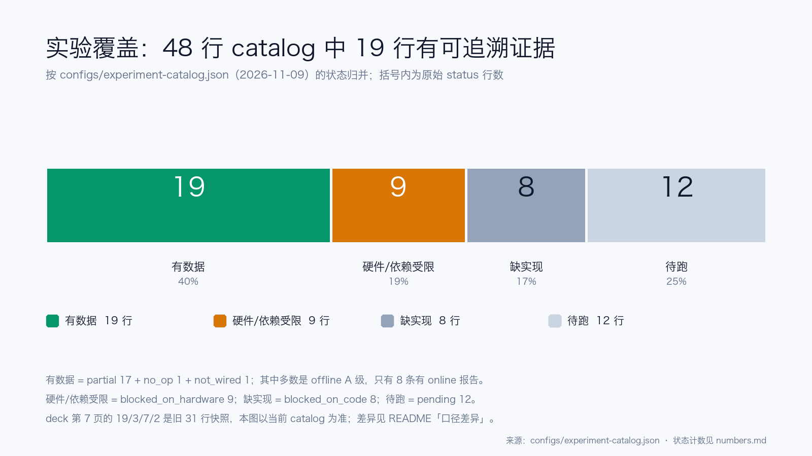

# 第 6 章 实验设计与评测协议

## 本章结论

- E0–E5 是一条链：先锁评测与基线，再做模块内选型，然后解释耦合、组合、环境与确认；每一级只回答一个问题，不把全局消融当作模块设计的替代。（来源：`docs/optimization/04-experiments.md` §4.3–4.4）
- A/B/C 三级评测用题量与指标换成本：A 级 60–120 题看接口与成本，B 级 120–351 题加 F1/Judge，C 级用留出集、多 seed、第二 Judge 与人工；A 级能筛，但不能替代 B 级。（来源：`docs/optimization/04-experiments.md` §4.3）
- 当前 catalog 48 行中 19 行有可追溯证据、9 行硬件/依赖受限、8 行缺实现、12 行待跑；受限与未实现单列，不混进“已完成”。（来源：`configs/experiment-catalog.json`）

## 6.1 E0–E5：每一级只回答一个问题

**表 6-1 E0–E5 的阶段与产出**

| 阶段 | 问题 | 主要产出 | 本项目状态 |
|---|---|---|---|
| E0 | 测什么、基线是多少、方差多大 | 评测协议、B0/R0/全文基线 | 部分：归档 27B + W3 |
| E1 | 每个模块怎么配最好 | 每模块 2–3 个候选 | 部分：S6 offline + online 单因素 |
| E2 | 模块之间谁带动谁、LLM 占多少 | 转化率、Oracle 差距、归因 | 部分：E2-1 转化；E2-2 retrieval oracle 已跑，其余 oracle 未跑 |
| E3 | 候选组合是否超加/次加 | 组合矩阵、Pareto | 部分：16 run 半因子 + online 2×2；Pareto 未跑 |
| E4 | 换 LLM/规模/场景，最优是否变 | 条件策略、regret | 未跑：API 网格设计保留 |
| E5 | 结论是否稳健 | 留出集、第二 Judge、多 seed | 部分：W3 test 2 段、2 seeds；无第二 Judge/人工 |

表 6-1 的“状态”列是报告可信度的核心。E0 的归档 27B 是 2026-11-04 的旧协议，不是本次重跑；E5 的 W3 是 offline + online 两套，但 online 只有 2 seeds、80 题、无 Judge（来源：`eval/archive/final-w3.json`、`final-w3-test-online.json`）。这些都在第 7 章逐项标注，不在本章提前“总结成完成”。

## 6.2 四层插拔

“插拔”不是一句口号，而是四个层次（来源：`deck/build_deck.py` 第 6 页；`docs/optimization/04-experiments.md` §4.2.1）：

1. **模块内组件**：图 on/off、审计 on/off、MMR/decay on/off。对应 E1.x.1。
2. **模块内实现**：Schema、融合、规划、状态解析的具体实现。对应 E1.x.2。
3. **参数**：k、λ、top_n、压缩预算、rrf_k。对应 E1.2。
4. **模块间 / 环境**：候选组合、LLM × 规模 × 场景。对应 E3/E4。

四层的目的不是“多跑”，而是保证一次只动一个东西。adoption 的 strict remove 就是第三层与第二层的交界：从 R0 里移除一个组件，其他不变；E3 的半因子则是第四层：五个模块候选同时变，但用 resolution V 把主效应与二因子交互分开（来源：`eval/archive/e1-adoption-offline.json`、`e3-offline.json`）。

## 6.3 A/B/C 三级评测

**表 6-2 A/B/C 三级评测**

| 级别 | 题量 | 看什么 | 用在哪 | 本项目的实际使用 |
|---|---|---|---|---|
| A | 60–120 | L1 模块 + L2 接口 + 成本 | 所有模块实验、参数扫描 | S6、R3、adoption、E3、params |
| B | 120–351 | A + F1/Judge | 候选比较、耦合 | W3 offline/online、S6 online 40 题 |
| C | 留出集 + 多 seed | B + 第二 Judge + 人工 κ | 最终确认 | 未完成；W3 只到 2 seeds |

表 6-2 的题量是设计值，不是每次都跑满。S6 的 online 单因素是 40 题/配置、4 个开发对话、1 个 seed；它属于“B 级答案 + A 级规模”的混合，报告把它标成 `partial`，不标 `done`（来源：`reports/experiments/E1-*-online.json`）。W3 的 test 是 80 题/配置（2 段 × 20 题 × 2 seeds），也不到 B 级上限 351；它的价值在“test 只读 + 2 seeds”，不在题量。

## 6.4 指标与三件套

质量指标分三层：答案层 F1、证据层 Recall@K / nDCG、状态层 state accuracy；成本层 tokens/题、P50/P95；可靠性层 error rate、跨 seed 方差（来源：`docs/optimization/04-experiments.md` §4.15.3）。本报告重点使用：

- **F1**：词级重叠，适合 LoCoMo 的短答案；开放域/多跳会低估正确性。
- **Recall@K / nDCG**：证据是否进入上下文、排序是否靠前；Full Text 没有检索，因此不报 Recall。
- **state accuracy / valid-set exact**：状态是否判对、有效集是否完全正确；只在 17 条自定义基准上有值。
- **tokens/题、P95**：成本与延迟；缺一项就写 `not_available`，不猜。

**三件套规则**：每条结论至少带质量 + tokens + P95；缺一项标 `not_available`。本报告的执行并不完美：archive 27B 有 F1/Recall/平均秒，但没有 tokens；S6 online 有 F1/Recall/tokens/P95，但没有 Judge；W3 test 有 F1/Recall/tokens/P95，但没有 state accuracy。报告在相应表格的脚注里逐项标注，不用“三件套齐全”一概而论。

## 6.5 统计与数据纪律

**配对 bootstrap。** 对同一题上的两个配置做配对重采样，1000 次，报告 95% 百分位 CI；按对话 cluster 重采样的版本用于 adoption/E3/R3，W3 的 bootstrap 是按题重采样（来源：`eval/archive/e1-adoption-offline.json`、`e3-offline.json`、`final-w3.json`）。按题重采样会低估同一对话内的相关性，W3 的 CI 应视为偏窄；第 8 章把它列为限制。

**显著性。** 只报“CI 是否跨 0”，不把 p 值当装饰。E3 的 schema ΔRecall +0.0038，CI [−0.0116, +0.0176] 跨 0，就写“不显著”；fusion ΔnDCG −0.0492，CI [−0.0638, −0.0347] 不跨 0，就写“显著为负”（来源：`eval/archive/e3-offline.json`）。

**数据纪律。** development 四段用于选型与调参；test 两段只在配置冻结后跑。W3 在 test 前冻结 B0/R0，两个 seed 只换题目子集，不换配置（来源：`docs/optimization/W3-REPORT.md`）。归档 27B 是 test 2 段、120 题；它和 W3 的 80 题不是同一题集，不能逐题配对。

## 6.6 覆盖：48 行，不是 31 行

*图 4 实验覆盖：48 行 catalog 中 19 有数据 / 9 受限 / 8 缺实现 / 12 待跑（来源：`configs/experiment-catalog.json`）。*

图 4 按 `configs/experiment-catalog.json` 的当前状态归并：partial 17 + no_op 1 + not_wired 1 = 19 行有数据；blocked_on_hardware 9；blocked_on_code 8；pending 12（来源：`configs/experiment-catalog.json`）。deck 第 7 页的 19/3/7/2 是旧 31 行快照，与当前 catalog 不同；本报告以 48 行为准，差异在 README 与 `numbers.md` 中登记。

“有数据”不等于“已完成”。19 行里有 8 行有 online 报告（grade=offline+online），其余多数是 offline A 级；`partial` 的原意就是“跑了，但关键指标或缺、或只有 offline”。附录 A 逐行给出 ID、状态与证据，避免用一张堆叠条掩盖细节。

A 在 19:17 另回传了 E2-2 retrieval oracle、E3 online 2×2、M2 cross-encoder 三个补充产物；它们不在 catalog 48 行的状态计数里，因此图 4 仍是 19/9/8/12。正文第 7 章引用时标“online 补充”，不把它们算成“已完成”的新行。

## 6.7 本章边界

本章说明“怎么测”，不说明“测出了什么”。A/B/C 的分级、三件套、cluster bootstrap 都是设计原则；实际执行有缺口：C 级未完成、W3 的 CI 按题、state accuracy 只有 17 条、online 单因素只有 1 个 seed。这些缺口不影响已写出的条件结论，但决定了它们不能升级为“最终结论”。第 7 章按“归档 27B → offline test → online 27B → 组件 → 组合 → 图 → 参数 → 维护”的顺序给出结果。
