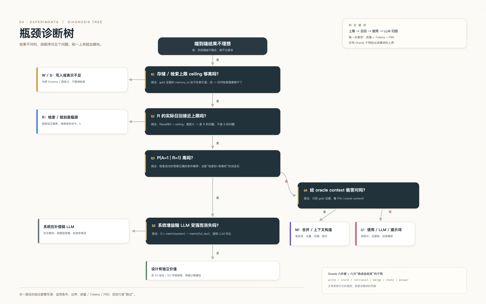

# 附录 A 实验清单、假因子与复现

## A.1 catalog 48 行摘要

下表按 `configs/experiment-catalog.json`（2026-11-09）逐行摘录；状态与 grade 保留原字段，证据列只写“有没有可追溯产物”，不把计划写成结果。`partial` = 跑了但关键指标缺或只有 offline；`blocked_*` = 当前环境/代码不可执行；`pending` = 设计存在但未跑；`no_op` / `not_wired` = 配置未消费或未接线。

**表 A-1 catalog 48 行摘要**

| ID | 状态 | grade | 证据摘要 |
|---|---|---|---|
| E0-1 | partial | offline | 归档 27B（2026-11-04，Full F1 0.5589）+ W3 offline test；27B 未重跑 |
| E1-W1 | partial | offline+online | S6 offline 6 run；E1-W1 online 40 题（W2 F1 0.1837 最高） |
| E1-W2 | partial | offline | append vs mem0_4action + audit；adoption resolver remove ΔRecall +0.0223（CI 跨 0） |
| E1-W3 | partial | offline | llm_audit 在 offline 是 no-op；audit remove 0，add 未编译 |
| E1-W4 | no_op | offline | fields 6/12、evidence flag 未读；无独立参数曲线 |
| E1-W5 | blocked_on_code | not_run | `memlab/write.py` 没有切分因子，S6 固定 turn/fact |
| E1-W-LLM | blocked_on_hardware | blocked | 需 7B/27B/72B 抽取；8GB M2 不可执行 |
| E1-S1 | blocked_on_code | not_run | 没有 turn/fact/event/summary 存储单元因子，也没有检索上限指标 |
| E1-S2 | partial | offline+online | S6 三表示 Recall 全 0.5053；R3 13 格；online S1/S2/S3 全 0.1837（online 为 `not_wired`） |
| E1-S3 | blocked_on_code | not_run | 无 L0–L3 分层；three_layer 是图表示，不是摘要层级 |
| E1-S4 | blocked_on_code | not_run | 有 index_hash，但无增量 vs 重建实验、无长期 F1 |
| E1-S-LLM | blocked_on_hardware | blocked | 图由缓存 facts/states 确定性构建，无 LLM 图抽取 |
| E1-R1 | partial | offline+online | S6 R1/R2/R3；online R2 F1 0.1540 最高；adoption planner remove +0.0333 |
| E1-R2 | pending | not_run | 通道存在，但无 6 路线 × 4 类别消融 |
| E1-R3 | partial | offline | 13 格 × 61 题；所有图实现 Recall 0.2372；图新增候选进入最终 0 |
| E1-R4 | not_wired | offline | k 修正后 10/15/25 有真实权衡；旧 k 曲线作废 |
| E1-R-LLM | blocked_on_hardware | blocked | planner_model 未接线；当前 analyzer/planner 是规则 |
| E1-M1 | partial | offline+online | S6 M1/M2/M3；online M1 F1 0.3064 最高；adoption fusion remove +0.0333 |
| E1-M2 | blocked_on_hardware | blocked | offline 全部回退；A 的 GPU 40 题对照见 `m2-rerank.json`，catalog 未更新 |
| E1-M3 | blocked_on_code | not_run | 4-order 只在 repo-c2；main 拒绝 `post.order`，`blocked_on_config` |
| E1-M4 | partial | offline | decay=off 下 MMR λ=0.9 vs 0.5 nDCG +0.00236；MMR×decay 未测 |
| E1-M5 | partial | offline | M3 query_adaptive 与 R0 post 混淆，无隔离 on/off |
| E1-M6 | blocked_on_hardware | blocked | top_n 20/50/100 flat；cross-encoder 回退，top_n 未生效 |
| E1-M-LLM | blocked_on_hardware | blocked | `llm_summary` 未注册，LLM rerank 未接线 |
| E1-U1 | partial | offline+online | S6 U1/U2/U3 Recall 全 0.5927；17 条状态基准 U1 0.3431 |
| E1-U2 | partial | offline | U2/U3 item mean 0.3627；valid-set exact 0.2353 |
| E1-U3 | blocked_on_hardware | blocked | 无 7B/27B/72B 回答模型；S6 用抽取式 |
| E1-U4 | pending | not_run | citation/refusal 只有描述统计，无隔离的噪声×验证实验 |
| E1-K1 | partial | offline+online | K1/K2/K3 store 级；K3 三指标改善，移除 490.75 units |
| E1-K2 | partial | offline | dedupe 移除 8.5，三指标基本不变 |
| E1-K3 | pending | not_run | 有一致性扫描动作，但无频率×矛盾率实验、无检测 F1 |
| E2-1 | partial | offline+online | offline P(A\|R)=0.1866 vs P(A)=0.2342；online 0.5657 vs 0.5200 |
| E2-2 | blocked_on_code | not_run | catalog 仍标 blocked；A 回传 retrieval oracle 80 题（F1 0.2437），write/store/merge/state/answer oracle 未做 |
| E2-3 | blocked_on_hardware | blocked | 需 ≥2 LLM 档位；只有单环境 |
| E2-4 | pending | not_run | 6 对 2×2 已设计，未跑 |
| E3-1 | partial | offline | 16 run 半因子；Recall 4 个主效应 0.000；A 另补 online 2×2（60 题/格，无 CI） |
| E3-2 | pending | not_run | 无组合矩阵/Pareto |
| E3-3 | pending | not_run | 4 对参数 2×2 已设计，未跑 |
| E3-4 | blocked_on_code | not_run | `bitemporal_invalidate` resolver 未实现 |
| E4-1 | blocked_on_hardware | blocked | 8GB M2 不能跑 7B/27B/72B 规模阶梯 |
| E4-2 | pending | not_run | 36 格 API tier 已编译，0 格运行 |
| E4-3 | pending | not_run | 规模网格存在，未跑；S6 只用 4 dev 段 |
| E4-4 | blocked_on_code | not_run | 只有 personal_assistant；代码/客服适配器未实现 |
| E4-5 | pending | not_run | query_mix 固定 balanced，未扫 |
| E4-6 | pending | not_run | context_budget 固定 32768，未扫 8k/32k/128k |
| E4-7 | pending | not_run | noise 固定 0，未扫 10%/30% |
| E4-8 | pending | not_run | update_rate 固定 static，未扫流式 |
| E5-1 | partial | offline+online | W3 offline/online test；2 seeds；无第二 Judge/人工 κ |

> catalog 更新时间早于 A 的第二批回传。A 在 19:17 另回传了 `e2-oracle-retrieval.json`、`e3-2x2.json`、`m2-rerank.json`；本表保留 catalog 原状态，正文第 7 章把这些产物标为 **online 补充**，不据此改写 48 行的状态计数。

## A.2 假因子与受限清单

“假因子”指配置里存在、但在当前 harness 下没有被消费或没有可测差异的轴。它们不能写成“无效”，只能写“当前不可识别”。

**表 A-2 假因子与受限清单**

| 因子/问题 | 状态 | 证据 | 正确写法 |
|---|---|---|---|
| `retrieval.k` 写死 | 已修 | executor 曾硬编码 k=15；修正后 10/15/25 有真实权衡 | 旧 k 曲线作废，引用 corrected |
| `graph.max_neighbors` 未接 | 已修，仍 flat | 接线后 10/40/80 相同；23/240 题用 graph_khop，cap 不 binding | 写“已接线但不 binding”，不写“参数无效” |
| `schema.params.evidence` 未读 | no_op | extractor 总是从 facts 派生 evidence，flag 从不读 | 写 `no_op`，不引用曲线 |
| MMR 被 decay 覆盖 | 部分修 | canonical order 下 decay 重排抹掉 MMR；关 decay 后 λ 有微效应 | 写“MMR×decay 未测”，不写交互 |
| 图通道覆盖低 | 受限 | rule analyzer 只把 8/61 category=1 判成 multi_hop | 写“路由/预算瓶颈”，不写“图无用” |
| `community_summary` / `hybrid_graph` | 未实现 | 注册为 `NotImplementedError`，不退化 k-hop | 写“未实现”，不写“无收益” |
| `bitemporal_invalidate` | 未实现 | E3c 没有该 resolver；E3-4 blocked_on_code | 写“未跑”，不写“时序无效” |
| Oracle（E2-2） | 只做 retrieval | A 的 80 题 oracle 只替换检索；其余 oracle 未做 | 写“retrieval oracle”，不写“完整上界” |
| cross-encoder | offline 受限；online 一次 40 题 | offline fallback；A 在 L20 跑 40 题，nDCG 升/Recall 降，单 seed 无 CI | 写“描述性”，不写“重排更好/更差” |
| 本地 7B/27B/72B | 受限 | 8GB M2；E4-1 blocked_on_hardware | 写“本地规模不可执行”，不写“规模无用” |
| `post.order` | blocked_on_config | main 拒绝 list；patch 只在 repo-c2 | 写“不可引用 order delta” |

## A.3 复现命令

```bash
# 环境
cd repo
python -m unittest discover -s tests -t .        # 全量测试

# offline test B0/R0
python scripts/final_w3.py --questions 20 --seeds 13 17

# R3 图检索
python -m memlab.experiments.cli run \
  --spec configs/experiments/e1-r3-graph.json \
  --executor e2e --offline --limit 60 \
  --db runs/r3-graph/r3.sqlite

# S6 六模块（offline）
python scripts/s6_e1.py --questions 80 --seeds 13 17 \
  --samples conv-26 conv-30 conv-43 conv-44

# S6 在线 27B（需要 Ollama；A 的运行 context=8192）
python scripts/s6_e1.py --online --questions 40 --seeds 13 \
  --samples conv-26 conv-30 conv-43 conv-44

# 状态基准
python scripts/state_accuracy.py
```

`scripts/repro.sh` 是交付层文件，本报告不修改；截至骨架写作时仓库中还没有该文件，因此上面给出的是各实验报告中已验证的命令，而不是对 `repro.sh` 内容的猜测。产物路径：`eval/archive/*.json`、`reports/experiments/*.json`、`runs/*/manifests/*.json`（runs 为 gitignored）。

## A.4 诊断顺序



*图 5 瓶颈诊断树：上限→召回→使用→LLM 归因（来源：`docs/optimization/figures/05-diagnosis-tree.png`）。*

图 5 是报告使用的诊断顺序（来源：`docs/optimization/figures/05-diagnosis-tree.png`）：端到端不理想时，先问“存储/检索上限够不够”，再问“实际召回是否接近上限”，然后问 `P(A|R=1)` 是否高、给 oracle context 能否答对、系统增益是否随 LLM 变强而消失；只有走完这条链，才决定是修 W/S、修 R、修 M/U，还是换 LLM。第 7 章的 R3、adoption、E3 都是按这个顺序解释的：先看候选层，再看最终层，最后才谈模块价值。

## A.5 图表与数字索引

- 图 1：`figures/hex-contract-ring.png`（第 3 章）
- 图 2：`figures/records.png`（第 2 章）
- 图 3：`figures/old-graph.png`（第 5 章）
- 图 4：`figures/coverage.png`（第 6 章）
- 图 5：`figures/diagnosis-tree.png`（附录 A.4）
- 表 7-1 至表 7-5：第 7 章；表 A-1/A-2：本附录
- 全部数字：`docs/report/numbers.md`
